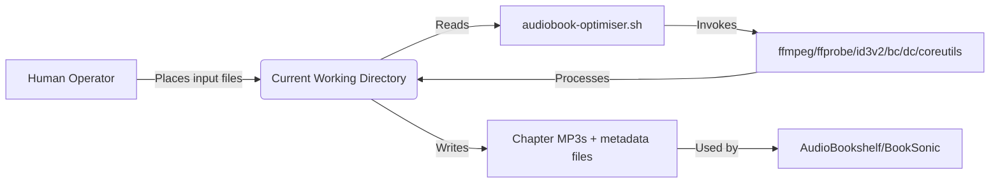
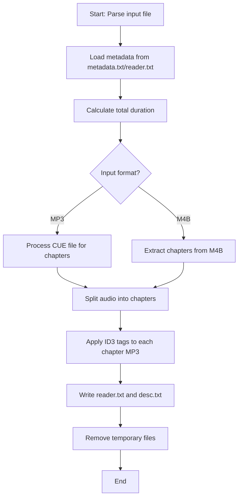

# audiobook-optimiser Architecture

This document describes the current architecture of the `audiobook-optimiser` Bash script.

## 📑 Table of Contents
- [🎯 Purpose](#-purpose)
- [🌐 System Context](#-system-context)
- [🏗️ Architectural Style](#-architectural-style)
- [🔄 Runtime Flow](#-runtime-flow)
- [🧩 Components](#-components)
- [🧭 Dependency Direction and Rules](#-dependency-direction-and-rules)
- [🚀 Deployment and Operations](#-deployment-and-operations)
- [✅ Testing and Verification](#-testing-and-verification)
- [⚠️ Design Constraints](#-design-constraints)

## 🎯 Purpose
`audiobook-optimiser` is a self-hosted Bash script that processes audiobook files (MP3 or M4B) with accompanying metadata and chapter information to produce tagged chapter MP3 files for audiobook servers like AudioBookshelf and BookSonic. It is intended for individual users managing local audiobook collections. The script has no network dependencies and operates entirely on the local filesystem.

## 🌐 System Context
The script runs in a user's local environment with no external network connections. It reads input files from the current working directory and writes output files to the same directory.

**System Boundary:** The script boundary includes the Bash process and its invoked command-line tools (ffmpeg, ffprobe, id3v2, bc, dc, GNU coreutils). All data remains on the local filesystem.

**Actors:**
- Human operator (user) who places input files (audiobook, metadata.txt, reader.txt, CUE/M4B) in the working directory and executes the script.

**External Systems:**
- None. The script does not communicate with any external services, APIs, or databases.

**Persistent Stores:**
- Input files: audiobook (MP3/M4B), metadata.txt, reader.txt, CUE sheet (for MP3) or embedded chapters (for M4B)
- Output files: chapter MP3 files, reader.txt (narrator output), desc.txt (description output)
- Temporary files: .chapters.txt, .tmp.txt (automatically cleaned up)

**Material Trust Boundaries:**
- The script trusts that input files are well-formed and that the required command-line tools are installed and functional. No validation is performed on input file integrity beyond basic existence checks.



The principal external boundaries are:
- **Filesystem:** Input audio files, metadata files, CUE sheets; output chapter MP3s and compatibility files
- **Command-line tools:** ffmpeg, ffprobe, id3v2, bc, dc, awk, sed, grep, sort (all invoked locally)

## 🏗️ Architectural Style
The script follows a **linear pipeline** architectural style with sequential processing stages. There are no distinct modules or layers; the architecture is embodied in the sequence of function definitions and the main execution flow. This style implies that changes to one stage may affect subsequent stages due to tight coupling through global variables and temporary files, but the linear flow makes the script easy to understand and modify for sequential workflows.


The principal architecture boundaries are:
- **Input Detection:** Responsible for identifying the input file and its format; permitted dependencies: none (uses only shell built-ins and coreutils)
- **Metadata Extraction:** Responsible for parsing metadata.txt and reader.txt; permitted dependencies: grep, awk, sed
- **Duration Calculation:** Responsible for computing total audio duration; permitted dependencies: ffprobe, bc, dc, awk
- **Chapter Extraction:** Responsible for parsing chapter timestamps from CUE or M4B files; permitted dependencies: ffmpeg (for M4B), grep, sed, awk (for CUE)
- **Audio Splitting:** Responsible for splitting the source audio into chapter MP3s; permitted dependencies: ffmpeg
- **ID3 Tagging:** Responsible for applying ID3 tags to chapter MP3s; permitted dependencies: id3v2
- **Cleanup:** Responsible for removing temporary files; permitted dependencies: rm (shell built-in)

## 🔄 Runtime Flow


The principal runtime sequence is:
1. **Initialisation:** Derive input file properties (name, format, directory) from arguments
2. **Metadata loading:** Read title, author, year, narrator, series info, description from metadata.txt; fallback to reader.txt for narrator
3. **Duration calculation:** Sum durations of all MP3 files in directory using ffprobe, bc, dc
4. **Format-specific chapter extraction:**
   - For MP3: parse CUE file to generate timestamp pairs
   - For M4B: use ffmpeg to extract chapter timestamps
5. **Audio splitting:** Use ffmpeg to split source audio into chapter MP3s based on timestamps
6. **ID3 tagging:** Apply comprehensive ID3 tags (title, artist, album, year, genre, track, comment) to each chapter MP3 using id3v2
7. **Compatibility files:** Write narrator to reader.txt and description to desc.txt for BookSonic
8. **Cleanup:** Remove temporary chapter timestamp file
9. **Termination:** Exit

## 🧩 Components
| Component | Responsibility | Principal Dependencies | Lifetime or Ownership |
|-----------|----------------|------------------------|-----------------------|
| `getDuration` function | Computes total audio duration from MP3 files | ffprobe, bc, dc, awk | Called during initialization; returns string |
| `getMetadata` function | Extracts a specific key from metadata.txt | grep, awk | Called by other metadata functions |
| `getTitle`, `getSubtitle`, `getFullTitle`, `getNarrator` functions | Resolve metadata fields with fallbacks | getMetadata, file existence checks | Called during initialization; return strings |
| `generateDescription` function | Constructs description from metadata | None (shell string operations) | Called during initialization; returns string |
| `getDescription` function | Returns description from metadata.txt or generated | getMetadata, generateDescription, cat | Called during initialization; returns string |
| `generate_chapters_list_from_cue` function | Parses CUE file into timestamp pairs | grep, sed | Called for MP3 input; modifies .chapters.txt |
| `generate_chapters_list_from_m4b` function | Extracts chapter timestamps from M4B | ffmpeg, grep, sed | Called for M4B input; modifies .chapters.txt |
| `extract_chapters_from_file` function | Splits audio into chapter MP3s using timestamps | ffmpeg | Called after chapter extraction; creates chapter MP3s |
| Main tagging loop (lines 212-340) | Applies ID3 tags and writes compatibility files | id3v2, echo | Processes each chapter MP3; creates tagged files and compatibility files |

All components exist for the lifetime of the script execution and are owned by the Bash process. No persistent components exist beyond the script runtime.

## 🧭 Dependency Direction and Rules
The script follows a strict **unidirectional data flow** from input to output with no feedback loops. Dependencies flow downward through the pipeline stages.


The principal dependency rules are:
- **Permitted dependency:** Each stage may only depend on the previous stage and shell built-ins/utilities
- **Prohibited coupling:** No stage may depend on a later stage (e.g., ID3 tagging cannot influence chapter extraction)
- **External tool usage:** All external tools are invoked as subprocesses with no shared state; dependencies are limited to the invocation context

## 🚀 Deployment and Operations
The script is deployed as a single executable Bash file. It requires no installation beyond making it executable (`chmod +x audiobook-optimiser.sh`) and ensuring the required command-line tools are available in the system PATH.

| Concern | Current Design | Architectural Consequence |
|---------|----------------|---------------------------|
| Process topology | Single-threaded, sequential Bash process | No concurrency concerns; simple debugging and monitoring |
| Persistent state | None; all state is in global variables and temporary files | Easy cleanup; no risk of stale state between runs |
| Filesystem requirements | Read/write access to current working directory | Must be run in a directory with appropriate permissions |
| Network requirements | None | Fully offline operation; no firewall or proxy configuration needed |
| Scaling assumptions | Processes one audiobook at a time; linear scaling with chapter count | Not suitable for batch processing without external loop operator |
| Startup responsibility | User verifies input files and tool availability | Clear failure mode if dependencies missing |
| Shutdown responsibility | Automatic cleanup of temporary files | No manual cleanup required; temporary files are removed |
| Operator-visible outputs | Progress messages to stdout; chapter MP3 files and compatibility files in working directory | User can monitor progress and verify output |

## ✅ Testing and Verification
The project has no automated test suite. Verification is manual through execution and inspection of output.

Execute the principal manual verification with:

```bash
# Place audiobook file (MP3 or M4B), metadata.txt, and optionally reader.txt and CUE file (for MP3) in a directory
./audiobook-optimiser.sh <audiobook_file>
# Verify chapter MP3 files are created with correct ID3 tags
# Verify reader.txt and desc.txt are created if applicable
```

**Verification boundaries:**
- **Input validation:** Confirmed by successful script execution and output generation
- **Metadata extraction:** Verified by checking tags in output MP3 files and compatibility files
- **Chapter splitting:** Verified by checking number and duration of output MP3 files matches input chapters
- **ID3 tagging:** Verified using ID3 tag readers (e.g., id3v2 -l) on output files
- **Compatibility:** Verified by importing output into AudioBookshelf or BookSonic and checking metadata display

**Material coverage gaps:**
- No validation of malformed input files (e.g., broken CUE, corrupt audio)
- No error handling for missing dependencies
- No testing of edge cases (e.g., special characters in metadata, very long chapter lists)

## ⚠️ Design Constraints
- **Single-file implementation:** All logic resides in one Bash script for simplicity and portability
- **POSIX compatibility:** Relies on standard Unix tools (ffmpeg, id3v2, bc, dc, awk, sed, grep) but assumes GNU extensions for some utilities (e.g., sort -h)
- **No external dependencies beyond standard media tools:** Avoids network calls, databases, or external services for simplicity and privacy
- **Linear processing:** Assumes sequential chapter processing; no support for parallel or out-of-order operations
- **Local-only operation:** All data remains on the local filesystem; no data leaves the user's control
- **Minimal error handling:** Relies on exit codes of invoked tools; no explicit error checking or recovery
- **Bash 4.0+ requirement:** Uses Bash-specific features (arrays, regex matching) but avoids overly complex Bashisms